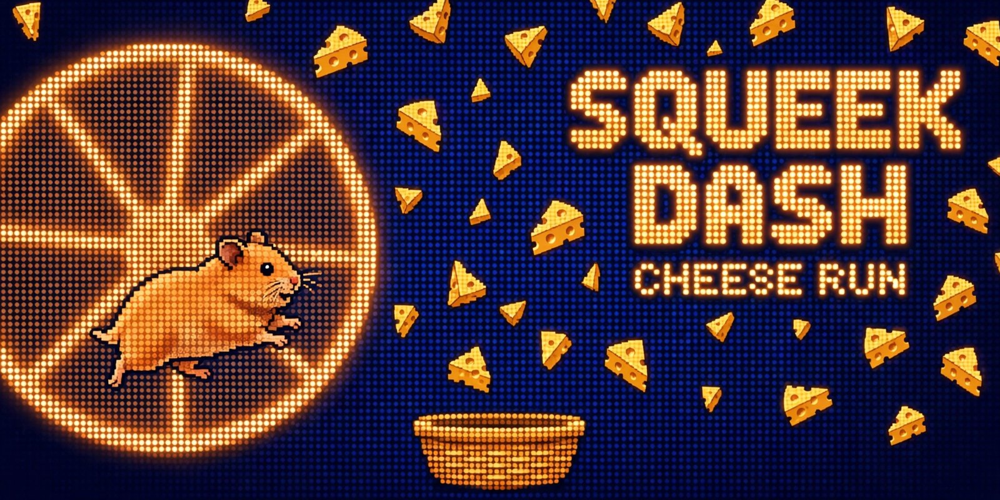

# Squeek Dash — Cheese Run

Squeek Dash is a community project for the Squeekchain Buildooooor badge.

A small browser game powered by Squeektoshi's real wheel. Cheese only falls
while the hamster is actually running: the game polls the public Squeekchain
API (`https://api.squeekchain.com/v1/status`) and maps his live speed and RPM
to the falling speed and spawn rate of the cheese. When he naps, the game
switches to a clearly labelled Dream Mode — translucent practice cheese at a
gentle fixed tempo, scored separately, no lives lost — because a sleeping
hamster shouldn't mean a dead game; the dream never pretends to be his wheel,
and the real score only ever comes from live running. No wallet, no tokens,
no transactions — just you, a basket, and however fast a hamster feels like
running.

## Play

Open `index.html` in any browser (or visit the live site). Move with the
mouse, touch, or the arrow keys. Catch cheese to score, chain catches for
combos, don't let three cheeses hit the floor.

## How it uses Squeekchain

- `GET /v1/status` every ~2 seconds (the API serves `Access-Control-Allow-Origin: *`).
- `measurement.coreStatus` gates gameplay: cheese spawns only while the wheel turns.
- `measurement.speedMmPerSecond` sets the falling speed; `measurement.rpmMilli`
  sets the spawn tempo and spins the wheel indicator at his real RPM.
- `builder.anchor.blockHeight` and `settledThroughRound` are shown in the live strip.
- If the feed is unreachable or stale, the game says so and pauses. It never
  fakes live data.

## Run locally

Any static file server works, e.g. `python3 -m http.server` in this folder,
then open `http://localhost:8000`.

## Notes

Community project, not affiliated with or endorsed by the Squeekchain team.
Squeekchain is a Sepolia testnet project; nothing here has monetary value.
